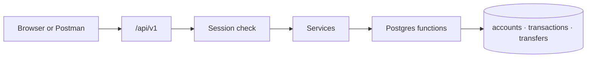

# LedgerFlow

Submission for the **Transaction Ledger API** assessment.

Stack: **Next.js** (App Router) · **TypeScript** · **Supabase / Postgres**.

---

## Submission pack (assessment §11)

| Item | Where |
|---|---|
| 1. Source code | This repository |
| 2. README | This file |
| 3. API documentation | [docs/API.md](docs/API.md) |
| 4. Assumptions | [Assumptions](#assumptions) below (also summarised in [docs/plan.md](docs/plan.md)) |

---

## What this is

A ledger where a signed-in user can:

1. Open accounts (balance always starts at `0`)
2. Credit or debit an account
3. Read balance and paginated history
4. Transfer money between accounts (bonus — including to another user)

Money rules (no overdraft, duplicate references, immutability, atomic updates) are enforced in **Postgres**, not only in TypeScript.

On top of the brief we added **auth** (what makes this multi-user), per-user isolation, and a small web UI so you can exercise the API without living in Postman. Details: [What we added beyond the brief](#what-we-added-beyond-the-brief).

---

## How to run

Needs Node 20+ and a Supabase project.

```bash
npm install
cp .env.example .env.local
# Fill SUPABASE_URL, SUPABASE_SERVICE_ROLE_KEY, AUTH_PEPPER
# Optional: ADMIN_USERNAME, ADMIN_PASSWORD (admin credit console)
# Apply SQL from supabase/migrations/ to the project
npm run dev
```

App: http://localhost:3000 · API base: http://localhost:3000/api/v1

| Env var | Role |
|---|---|
| `SUPABASE_URL` | Project URL |
| `SUPABASE_SERVICE_ROLE_KEY` | Server-only DB access (never expose to the browser) |
| `AUTH_PEPPER` | Secret mixed into password/MPIN hashes (≥ 32 chars) |
| `ADMIN_USERNAME` / `ADMIN_PASSWORD` | Optional admin login (credit-only) |

---

## How to verify (three paths)

### 1. Automated suite (recommended)

```bash
npm run dev                 # terminal 1
npm run test:e2e            # terminal 2 — hits the real DB
npm run test:e2e -- --offline
```

Covers: register/login (password + MPIN), lockout, cookie sessions, create account at `0`, credit/debit walkthrough (`+100 +50 −30 −20 = 100`), insufficient balance, duplicates, history filter/pagination, isolation, transfers (own + peer), concurrency, admin credit, page redirects.

### 2. Browser walkthrough

1. Open `/register` — set **name**, **username**, password, MPIN → land on dashboard
2. **New account** — note the account id (shown after create and on the account page)
3. Open the account → **Add money** / **Withdraw** → check Activity tabs and pagination
4. Open a second account → **Transfer** (own account or paste another user’s account id)
5. Sign out → confirm you cannot open `/dashboard` without a session
6. Optional: **Login as admin** → credit any account (cannot withdraw/transfer)

### 3. API with curl / Postman

```bash
curl -s -X POST localhost:3000/api/v1/auth/register -H "Content-Type: application/json" \
  -d '{"name":"Alice Khan","username":"alice","password":"correct-horse-1","mpin":"4821"}'

curl -s -X POST localhost:3000/api/v1/auth/login -H "Content-Type: application/json" \
  -d '{"method":"password","username":"alice","password":"correct-horse-1"}'
# Use data.token as: Authorization: Bearer <token>

curl -s -X POST localhost:3000/api/v1/accounts \
  -H "Authorization: Bearer $TOKEN" -H "Content-Type: application/json" \
  -d '{"name":"Savings"}'
```

Every endpoint, error code, and example: [docs/API.md](docs/API.md).

---

## Mapping to the assessment

| Spec | What to look for | Status |
|---|---|---|
| §1 Create account | `POST /api/v1/accounts` — system id/`created_at`, balance `0.00`, body cannot set balance | Done |
| §2 Add transaction | `POST /api/v1/accounts/:id/transactions` — credit/debit, reject overdraft, unique `reference_id` | Done |
| §3 Balance | `GET /api/v1/accounts/:id/balance` | Done |
| §4 History | type filter, `page`/`limit` meta, latest first | Done |
| §5 Integrity | txs immutable (API `405` + DB triggers); balance = Σ credits − Σ debits | Done |
| §6 Atomicity | one SQL function inserts the tx and updates balance | Done |
| §7–8 Validation & errors | Zod + `{ error: { code, message, details? } }` | Done |
| §9 Bonus transfer | `POST /api/v1/transfers` — atomic; rollback on failure | Done |
| §10–11 | Runnable locally; this README; API.md; assumptions below | Done |

Details and curls: [docs/API.md](docs/API.md). Traceability: [docs/plan.md](docs/plan.md).

---

## Guide through the product

### Auth — extra, but this is what makes it multi-user

Auth is **not** in the original brief. Without it the ledger is a single open API: anyone could create accounts, credit money, or touch any id they guessed. **Login is what turns that into a multi-user system** — every ledger call is tied to a user, and one person cannot see or move another’s money.

- Register with **name** (shown in the UI) and **username** (login handle), plus password and a 4–6 digit MPIN.  
- Login with either password or MPIN.  
- Browser keeps an HttpOnly `lf_session` cookie; curl/Postman can send `Authorization: Bearer …`.  
- Secrets are scrypt-hashed with a server pepper. Five failed logins lock that user for 15 minutes.  
- Unknown user and wrong secret return the same `401` (no easy username probing).

### Accounts (§1) — scoped to the signed-in user

- Create with a name only. Balance is always `0.00` (DB default; client `balance` is rejected).  
- List/get only **your** accounts. Another user’s id looks like a missing id (`404`).

### Transactions (§2–4)

- Credit and debit with decimal strings (`NUMERIC(18,2)`).  
- Debit with insufficient funds → `422`, balance unchanged.  
- Same `reference_id` on the same account → `409` + existing tx; balance unchanged. Same reference on a **different** account is allowed.  
- History: filter `credit`/`debit`, paginate, sort newest first.

### Transfers (§9 + peer)

- Source must be yours and funded. Destination may be yours **or** another user’s.  
- Both legs and the transfer row commit together (or nothing does).  
- If the destination is someone else’s, `to_balance` is omitted so you cannot spy on their balance.  
- `GET /accounts/lookup/:id` confirms recipient name without returning balance.

### Integrity (how money stays consistent)

- `accounts.balance` changes only via an insert trigger on `transactions` — not via a free-form UPDATE from the app.  
- Ledger tables reject UPDATE/DELETE/TRUNCATE.  
- Concurrent debits use row locks so the balance cannot go negative.  
- RLS is enabled with no client policies; only the server service role talks to the DB.

### Web UI (extra)

- Dashboard, account page (add / withdraw / history), transfer page, optional admin credit console.  
- Unsigned visitors are sent to `/login` (`proxy.ts`). API routes still return JSON `401`, not HTML redirects.



---

## What I added beyond the brief

The brief is a ledger API for a trusted caller. **Auth is what makes it multi-user**; the rest below supports that model and makes the API easy to demo.

| Addition | Why it’s here |
|---|---|
| Auth (password + MPIN) | **This is what makes it multi-user** — without login, anyone could credit or read any account |
| Display name | Username stays a login handle; UI greets people by name |
| Isolation (`404` for foreign ids) | Stops account-id probing and cross-user writes |
| HttpOnly cookie | Browser sessions without exposing the token to JS |
| Login lockout | Slows password/MPIN guessing |
| Peer transfer + lookup | Bonus transfer is more useful if you can pay someone else safely |
| Admin credit console | Optional ops path; users still self-credit per §2 |
| Web UI + page gate | Lets a reviewer walk the flows without writing every curl |
| `npm run test:e2e` | Locks the spec examples and isolation rules |
| `GET /health` | Simple liveness / DB check for hosting |

If you stripped these away, the §1–§9 ledger behaviour would still match the brief for a single trusted client. They are not substitutes for the required endpoints.

---

## Assumptions

1. **Auth is required** for every ledger route except `register`, `login`, `admin/login`, and `/health`. The brief did not specify auth; **auth is what makes it multi-user** — without it, isolation is meaningless.
2. Register stores **name** (display) and **username** (unique login).
3. Users **may credit** their own accounts (brief §2). Admin credit is an extra path, not a replacement.
4. Transfers may target **another user’s** account; the source must belong to the caller.
5. A well-formed UUID that belongs to someone else returns `404 ACCOUNT_NOT_FOUND`, same as a missing id, for read/debit/history (no existence leak).
6. Amounts are `NUMERIC(18,2)`; responses use decimal **strings**.
7. Duplicate `reference_id` → `409` with the existing transaction in `details` (not a silent `200`).
8. Login lockout is **per username**. A production deploy should also rate-limit by IP at the edge.
9. Currency symbol in the UI (`₹`) is display-only; the API is currency-agnostic.
10. Test data is not deleted (ledger is append-only); each e2e run uses fresh random usernames.

---

## Project layout (where to look)

```
app/api/v1/          REST handlers
app/(app)/           Signed-in UI
app/(auth)/          Login / register
app/admin/           Admin credit UI
lib/services/        Auth + ledger use-cases
lib/auth/            Sessions, hashing, admin
lib/validation.ts    Zod schemas
supabase/migrations/ Schema, triggers, RPC
scripts/e2e.mjs      End-to-end checks
docs/API.md          API contract
docs/plan.md         Build plan / checklist
```

---
